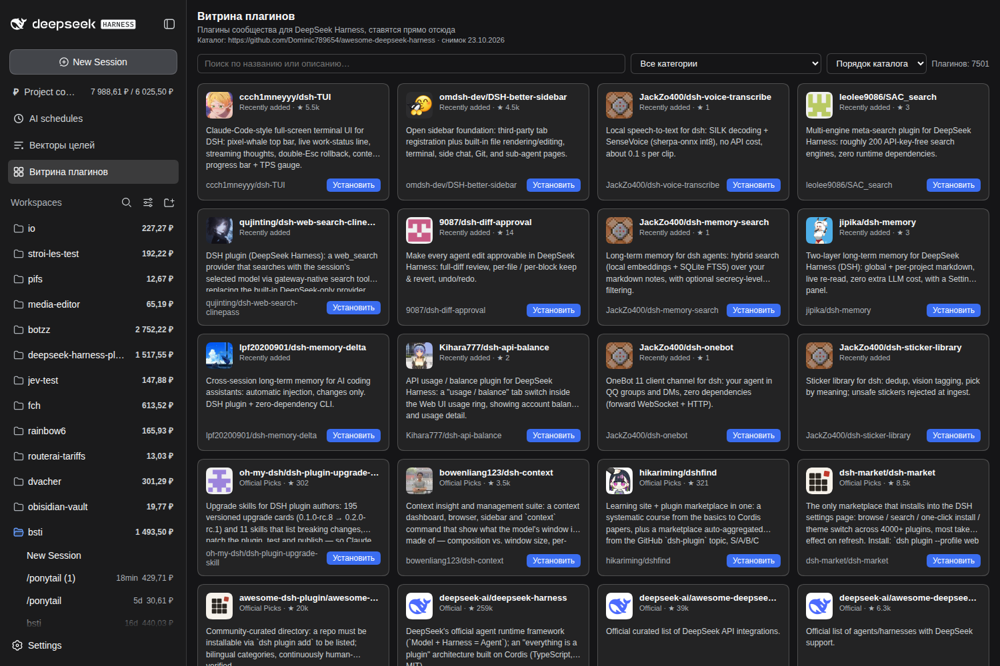

# dsh-plugin-showcase

Витрина плагинов DeepSeek Harness: страница с каталогом community-плагинов —
картинка, название, описание, звёзды, ссылка на GitHub и кнопка
«Установить» / «Удалить». Каталог берётся из
[`Dominic789654/awesome-deepseek-harness`](https://github.com/Dominic789654/awesome-deepseek-harness).



## Зачем

Плагин для DSH ставится командой `dsh plugin --profile web add github:owner/repo`,
но чтобы её набрать, надо сначала найти плагин: пролистать awesome-список,
прочитать, что он делает, и не перепутать имя репозитория с именем пакета.
Витрина делает это одним окном: каталог с поиском и категориями, у каждой
записи — описание и ссылка на репозиторий, а кнопка запускает ту же команду
`dsh plugin`, что человек набрал бы руками.

## Как устроено

**Хост** (`lib/index.js`) отдаёт пять роутов:

| Метод | Путь | Что делает |
|---|---|---|
| GET | `/api/plugin-showcase/catalog` | страница каталога: `page`, `perPage`, `q`, `category`, `sort` |
| GET | `/api/plugin-showcase/installed` | что уже стоит в профиле |
| GET | `/api/plugin-showcase/stars` | живые звёзды с GitHub для видимых карточек |
| POST | `/api/plugin-showcase/install` | `dsh plugin --profile <профиль> add github:owner/repo` |
| POST | `/api/plugin-showcase/remove` | `dsh plugin --profile <профиль> remove <пакет>` |

**Клиент** (`lib/client.js`) — строка в сайдбаре и страница в основной области:
поиск с задержкой, фильтр по категории, сортировка по звёздам, сетка карточек
и постраничный переход. Английский, китайский и русский словари.

## Каталог

Снимок лежит в пакете — `lib/catalog.snapshot.json`, **7501 запись** из 22
категорий, 1.7 МБ. Поэтому витрина работает без сети.

Пересобрать снимок (нужна сеть):

```sh
node scripts/build-catalog.mjs            # обновить lib/catalog.snapshot.json
node scripts/build-catalog.mjs --dry-run  # только посчитать, не писать
```

Скрипт разбирает README awesome-списка. Неочевидные места, которые он учитывает:

- **Две формы строки.** Обычная `- [owner/repo](url) — описание` и с ведущей
  ссылкой на сайт `- [Сайт](…) · [owner/repo](github…) — описание`; во второй
  берётся GitHub-ссылка, а не сайт.
- **Хвосты в описании.** `⭐123`, `· Team pick …` и `· [post](…)` вырезаются,
  в карточку идёт только текст.
- **Дубликаты.** Один репозиторий может встретиться в нескольких категориях —
  остаётся первое вхождение.
- **Ресурсы и оф. список** помечены `installable: false`: у них нет
  репозитория-пакета, ставить нечего.

### Звёзды

В снимке звёзды есть только у 587 записей: awesome-список хранит их
нерегулярно. Витрина дозапрашивает актуальные для **видимой страницы** через
shields.io и кладёт в `$DSH_HOME/plugin-showcase-stars.json` на шесть часов.
Замерено: 24 карточки холодными — 1.7 с, из кеша — мгновенно. Неудачный
запрос не ломает страницу: остаётся значение из снимка.

### Картинки

Аватар владельца репозитория (`https://github.com/<owner>.png?size=80`) —
единственная картинка, которая есть почти у каждой записи. Грузится напрямую с
github.com; если не загрузилась, остаётся монограмма из первой буквы.

## Установка и удаление

Кнопка запускает ту же команду, что человек набрал бы в терминале, — тем же
`node`, которым работает харнесс:

```sh
dsh plugin --profile web add github:owner/repo
dsh plugin --profile web remove <имя-пакета>
```

Профиль определяется из `--profile` в argv процесса харнесса (по умолчанию
`web`). Имя npm-пакета часто отличается от имени репозитория (`dsh-TUI`
ставится как `dsh-tui`), поэтому «уже установлен» определяется по полю
`repository` в `package.json` установленного пакета, а не по имени.

**Изменение вступает в силу после перезапуска профиля** — страница так и
пишет после каждой установки. Установка идёт синхронно, до трёх минут; для
плагина с GitHub обычно 5–15 секунд.

## Подключение

```yaml
- insert:
    - id: plugin-showcase
      name: 'file:///home/io/.dsh/profiles/node_modules/dsh-plugin-showcase/lib/index.js?rev=1'
      config: {}
```

`config.profile` переопределяет имя профиля, если оно не читается из argv.

## Проверка

```sh
node scripts/catalog-test.mjs   # разбор awesome-списка
node scripts/host-test.mjs      # роуты, пагинация, поиск, чтение профиля
node scripts/client-smoke.mjs   # клиентский бандл и регистрации
```

## Известные ограничения

- Снимок каталога статичен: новые плагины появляются в витрине после
  `build-catalog.mjs`.
- Установка синхронная: если `pnpm` думает долго, кнопка остаётся занятой.
- Ставится `github:owner/repo` без указания ветки: репозиторий, у которого
  код только на нестандартной ветке, потребует ручной команды с `#branch`.
